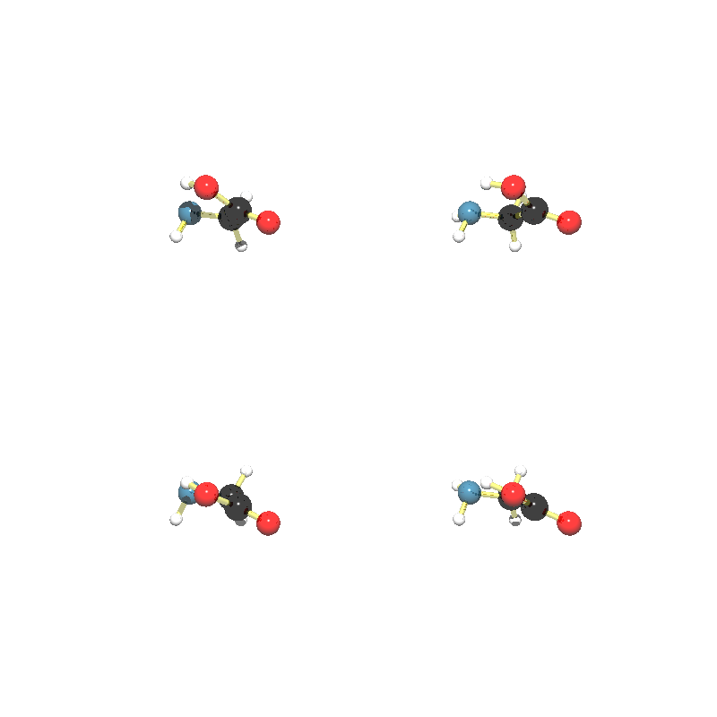

# A07 – Glycine Molecules in POV-Ray

This assignment creates a 3D visualization of four glycine molecules placed at the vertices of a square using Open Babel and POV-Ray.

The molecular structure is converted from SMILES to POV-Ray format using Open Babel. The resulting molecule is then included four times in the final scene using the `#include` directive.

## 1. Clone the repository

Open a terminal and run:

```bash
git clone https://github.com/TomasVav/ci2.git
cd ci2/A07
```

## 2. Prepare the environment

This assignment uses Open Babel and POV-Ray. No Python virtual environment is required because both programs are standalone applications.

Install the following software:

- [Open Babel](https://openbabel.org/)
- [POV-Ray](https://www.povray.org/download/)

Make sure Open Babel is accessible from the command line.

On Windows, POV-Ray can be launched using the full path to its executable.

## 3. Create the molecular structure

The glycine molecule is represented by the following SMILES notation:

```text
NCC(=O)O
```

This structure is saved in the file `gly.smi`.

## 4. Convert SMILES to POV-Ray

Use Open Babel to generate a 3D molecular structure and convert it to POV-Ray format:

```bash
obabel gly.smi -O gly.pov --gen3d
```

The generated file `gly.pov` contains the molecular geometry and the POV-Ray object definition.

The file is edited to remove the standalone molecule rendering command and the original camera, lighting, and background settings.

The auxiliary file `babel_povray3.inc` is required for rendering and can be obtained from the [Open Babel GitHub repository](https://github.com/openbabel/openbabel/blob/master/data/babel_povray3.inc).

## 5. Create the square arrangement

The file `gly4.pov` uses the `#include` directive to import the glycine molecule:

```text
#include "gly.pov"
```

Four copies of the molecule are placed at the following coordinates:

| Molecule | X | Y | Z |
|---|---|---|---|
| 1 | -5 | 5 | 0 |
| 2 | 5 | 5 | 0 |
| 3 | -5 | -5 | 0 |
| 4 | 5 | -5 | 0 |

These coordinates form a square in the XY plane.

## 6. Render the image

On Windows, run the following command in PowerShell:

```powershell
& "C:\Program Files\POV-Ray\v3.7\bin\pvengine64.exe" /RENDER gly4.pov +Ogly4.png +W800 +H800 +FN
```

The command generates an 800 × 800 pixel PNG image named `gly4.png`.

The exact path to POV-Ray may differ depending on the installation.

## 7. Result

The resulting image shows four glycine molecules arranged at the vertices of a square.



## 8. Files

- `gly.smi` – SMILES representation of glycine.
- `gly.pov` – molecular structure generated by Open Babel and subsequently edited.
- `gly4.pov` – main POV-Ray scene containing four molecules.
- `babel_povray3.inc` – auxiliary Open Babel rendering definitions.
- `gly4.png` – final rendered image.
- `README.md` – assignment description and instructions.